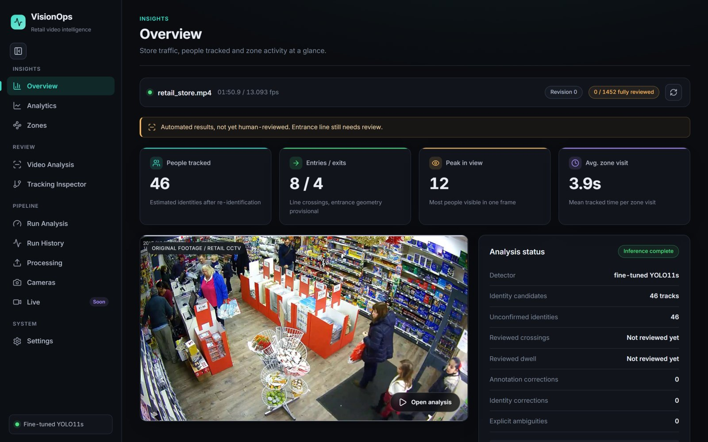
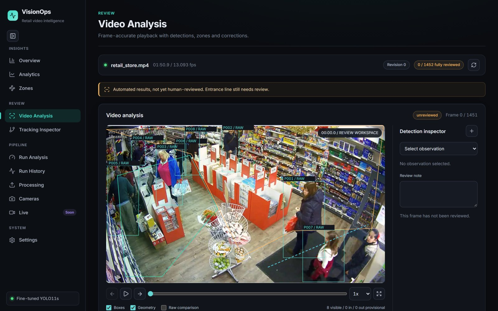
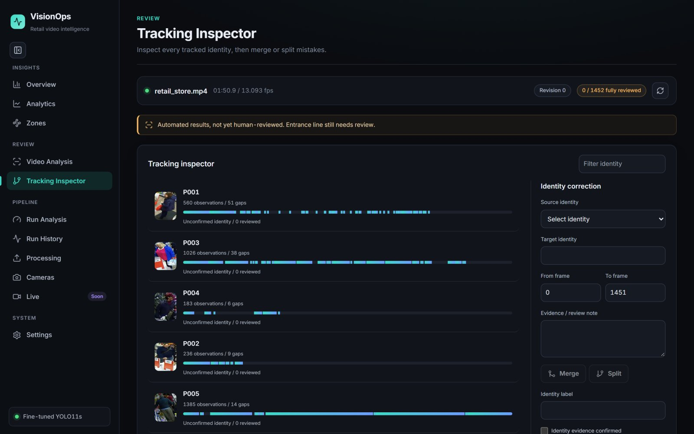
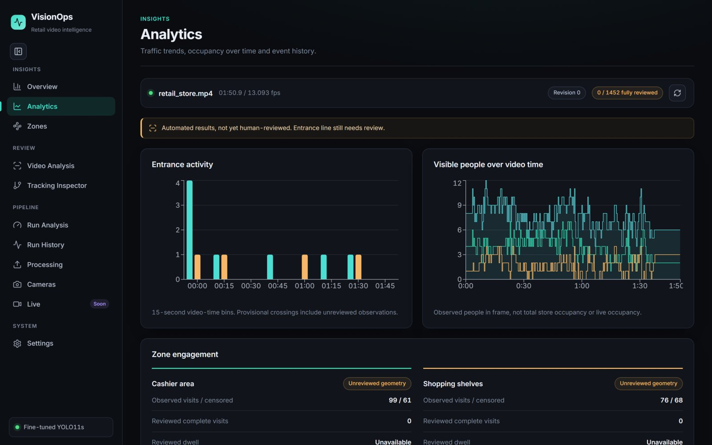
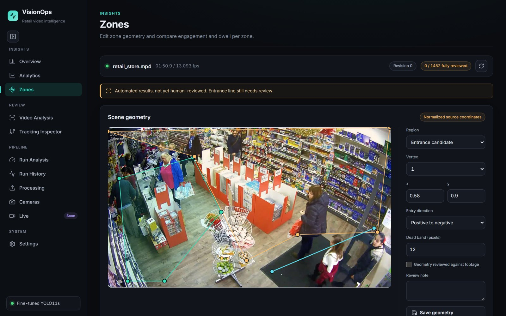
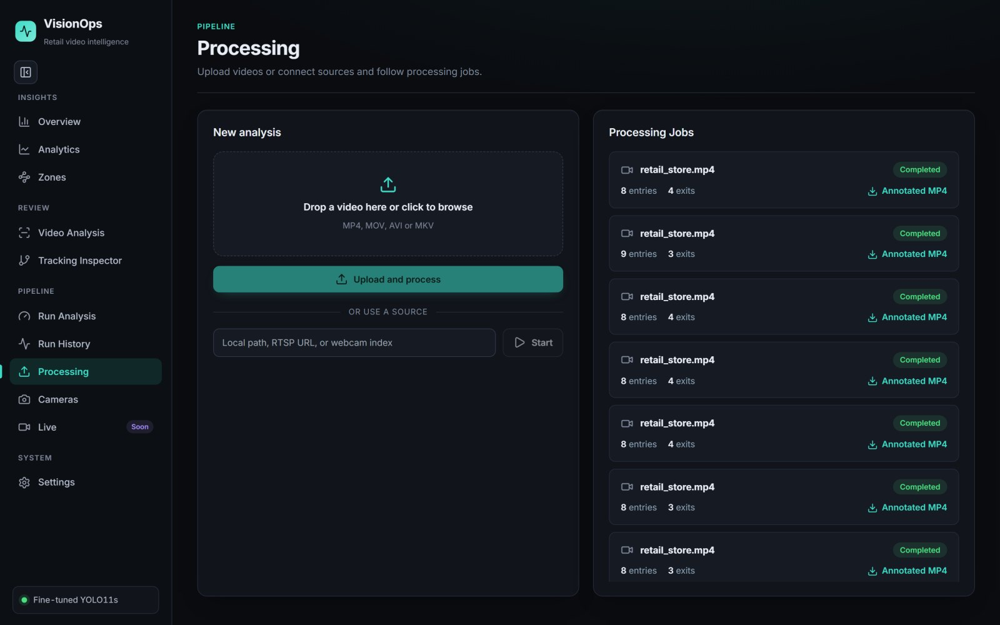
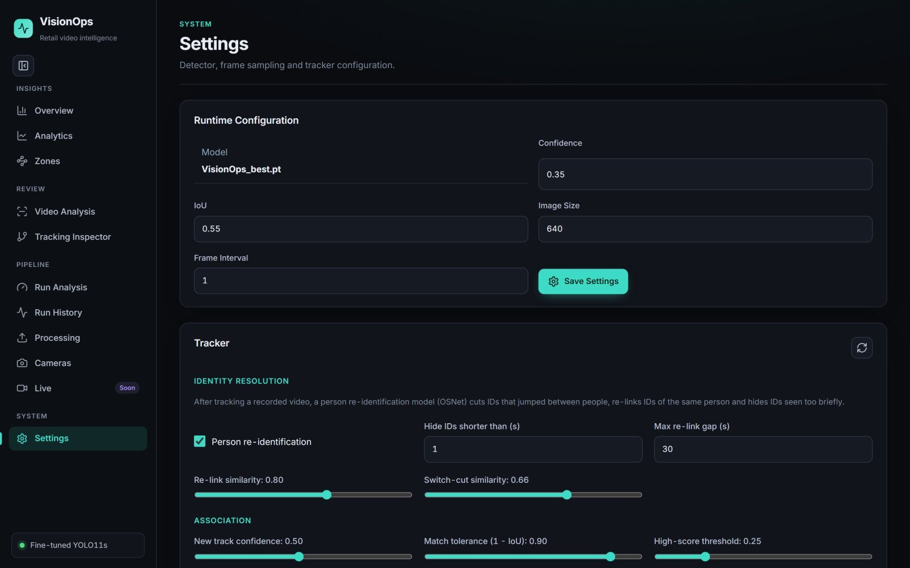
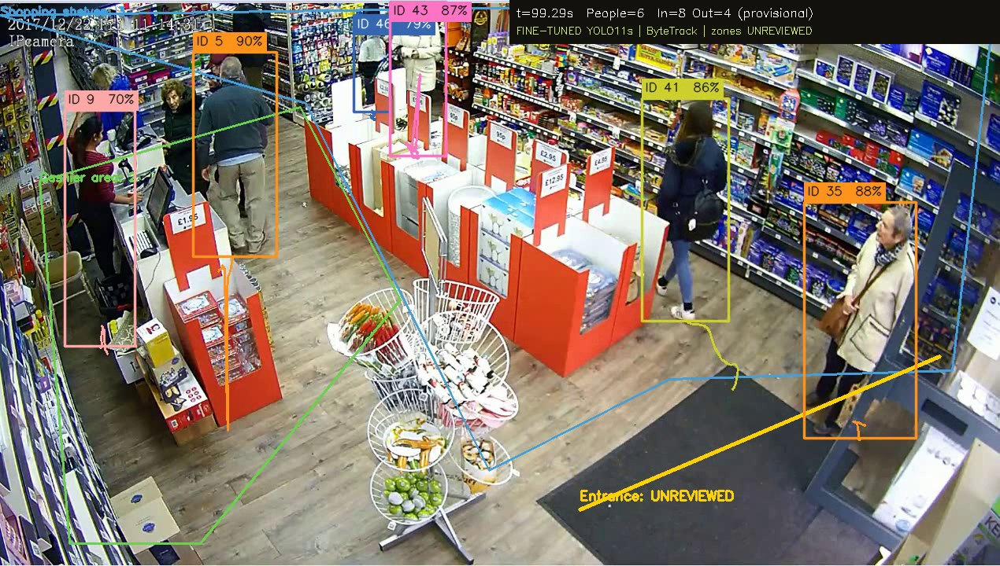

# VisionOps

AI-powered retail video analytics MVP using YOLO11 person detection, ByteTrack tracking, OSNet person re-identification, FastAPI, SQLite, and a React dashboard.



## Screenshots

| Video analysis | Tracking inspector |
|---|---|
|  |  |
| **Analytics** | **Zone editor** |
|  |  |
| **Processing** | **Tracker settings** |
|  |  |

Annotated output (one color per tracked identity):



## Tracking Quality

Measured on a real 111-second, 13 FPS retail CCTV clip (3–13 people in view):

| Stage | Track IDs | IDs living < 2 s |
|---|---|---|
| Ultralytics ByteTrack defaults | 138 | 61 |
| ByteTrack tuned for low FPS (`new_track_thresh=0.5`, `match_thresh=0.9`, 90-frame buffer) | 63 | 8 |
| + OSNet ReID: 17 identity-switch cuts, 27 re-links, 7 sub-second IDs hidden | **46** | 0 |

Stock ByteTrack thresholds assume ~30 FPS. At low CCTV frame rates people move further between frames, IoU association fails, and every miss spawns a new ID. For recorded video, `visionops/vision/identity.py` runs after tracking: it cuts a track where its person-ReID appearance changes abruptly (an ID switch), re-links non-overlapping segments that look like the same person, and drops identities seen for less than `min_track_seconds`. Every split and merge is written to `identity_resolution.json`.

No identity ground truth exists for this clip, so these are proxy measures, not IDF1 or ID-switch rates. Visual inspection suggests roughly 30–35 distinct people, so some fragmentation remains.

## What Works

- Configurable YOLO checkpoint loading with `VisionOps_best.pt` detected by default and `yolo11s.pt` fallback.
- Video upload or local/RTSP/webcam source job creation.
- ByteTrack-based person tracking through Ultralytics.
- Direction-aware entry/exit line crossing with duplicate prevention.
- Polygonal zone entry/exit and timestamp-based dwell time.
- Historical visible-person counts, separate from unavailable live occupancy.
- Persisted jobs, events, zones, cameras, and zone visits in SQLite.
- Annotated MP4 export for completed jobs.
- REST APIs, CSV export, and WebSocket analytics stream.
- React dashboard with overview, live monitoring, video analysis, zones, analytics, cameras, and settings pages.
- Automated tests for line crossing, zone dwell, occupancy, and API validation.

## Setup

```bash
python -m venv .venv
.venv\Scripts\activate
pip install -r requirements.txt
python scripts/init_db.py
python scripts/load_default_config.py
uvicorn backend.app.main:app --reload
```

In a second terminal:

```bash
cd frontend
npm install
npm run dev
```

Open `http://localhost:5173`. The API runs at `http://localhost:8000`.

## Model

Model weights are not committed. Place the fine-tuned detector at `VisionOps_best.pt`; if it is missing, the backend reports the fallback and uses `yolo11s.pt`, which Ultralytics may download on first use.

Person re-identification is enabled by default and needs the OSNet-AIN MSMT17 weights from the torchreid model zoo:

```bash
pip install torchreid gdown
python -m gdown 1SigwBE6mPdqiJMqhuIY4aqC7--5CsMal -O models/osnet_ain_x1_0_msmt17.pt
```

To run without it, turn off **Person re-identification** in Settings (or set `reid_enabled: false` in the tracking config).

## Processing A Video

1. Start the backend and frontend.
2. Open the Video Analysis page.
3. Upload an MP4/MOV/AVI/MKV or enter a local path, RTSP URL, or webcam index like `0`.
4. Wait for the job status to become `completed`.
5. Download the annotated MP4 from the job list.

## Real Retail Test

The first test uses `data/videos/retail_store.mp4`. If the file was supplied at
`data/retail_store.mp4`, the inspection command copies it to the requested location.

```powershell
python scripts/inspect_retail_video.py
python scripts/run_retail_test.py
python scripts/review_retail_test.py
```

Install ffmpeg with an H.264 encoder and put it on PATH. The runner processes every
frame with the local `VisionOps_best.pt` when it loads, and explicitly records any
pretrained `yolo11s.pt` fallback. ByteTrack is invoked with `persist=True` for the
same video stream, following the [Ultralytics tracking API](https://docs.ultralytics.com/modes/track/).

All retail test artifacts are under `outputs/retail_store_test/`: browser-compatible
`annotated.mp4`, `events.csv`, `events.json`, per-frame `tracks.jsonl`,
`frame_metrics.csv`, `occupancy.json`, `zone_visits.json`, effective model/geometry
configuration, evidence pairs, `summary.json`, and `test_report.md`.

Open **Retail Test** in the React dashboard for the actual video, measured FPS and
latency, occupancy charts, event timeline, evidence, and report downloads. The
**Geometry** view edits normalized polygon vertices and entrance-line endpoints;
save changes and run again to apply them. The API exposes the same workflow at
`GET /api/retail-test`, `GET/PUT /api/retail-test/config`, and
`POST /api/retail-test/run`. Both Retail Test and Overview read completed analytics
from the same backend database. Processing persists jobs, all events, zone visits,
censoring flags, summaries, and occupancy timelines before reporting completion.
Files are exports and media, not a second dashboard data source.

The entrance line and zones start **unreviewed**. The operator must review the
location and direction before marking them reviewed. A candidate line crossing
is not proof of a physical doorway crossing. Counts do not establish current
store occupancy, and distinct tracker IDs are not distinct people. Zone occupancy
uses observed bounding-box bottom centers. Dwell uses video timestamps; unknown
entry times, lost tracks, and video-end spans are censored. No ground truth
accuracy is asserted.

With the frontend and API running, optional browser/artifact verification uses
Playwright and writes its checks and screenshots to the same output directory:

```powershell
pip install playwright
python -m playwright install chromium
python scripts/verify_retail_test.py
```

Sampled qualitative observations can be stored as `manual_review.json` with the
current `run_id` and an `observations` array of `category`, `timestamp`, `finding`,
`evidence`, and `status`. Only observations for the current run appear in the
report. A rerun replaces the primary test artifacts; older manual observations
are not automatically attributed to a new run.

## Overview Data And Persistence

The former integration gap was a split data path: Retail Test read JSON artifacts,
while Overview queried empty SQLite job/event/visit tables. Startup now applies a
non-destructive schema migration and idempotently imports a completed legacy
retail run. No mock analytics are seeded. Back up `visionops.db` before
deployment; the local pre-migration backup is in the test output's `integration/`
directory.

Overview defaults to the latest completed analysis. Its selector supports an
individual run or all videos; all-videos uses only the latest completed run per
video SHA-256, preventing reruns from doubling counts. Traffic is bucketed by
elapsed video time, not wall-clock store traffic. History retains older runs;
immutable video/evidence exports live under `outputs/retail_store_test/runs/`.

`GET /api/analytics/overview?analysis_id=latest|all|<job-id>` returns the selected
metrics, traffic, recent events, zone aggregates, and history. The traffic and
zones endpoints accept the same selector. The dashboard polls every three seconds
and refreshes on a processing-completion notification. It includes loading, empty,
API-error, and stale-response states rather than replacing failures with zeros.

Entry/exit counts remain provisional until entrance geometry is reviewed. Tracker
IDs are run-scoped identifiers, not unique customers. Current live occupancy and
unique customers are unavailable; historical final/peak visible tracks are labeled
separately and are not summed across independent videos.

Dwell aggregates pool visit durations, not per-zone means: the mean tracked span
includes measured censored visits; the complete-only mean excludes unknown entry,
lost-track and video-end spans, and legacy visits with unknown censoring. Open,
negative or timestamp-inconsistent durations are incomplete and excluded. Counts
for each category remain visible. These spans are estimates, not validated customer
dwell or evaluation accuracy. Imported legacy runs with no recorded completion
timestamp show that timestamp as unavailable.

```powershell
python -m pytest -q
python scripts/verify_overview.py
cd frontend
npm run build
```

Integration tests use a saved real retail result in an isolated temporary database.
They cover idempotent import, matching Retail/Overview reads, video selection,
latest-per-video deduplication, censoring, empty states, completion persistence,
and migration preservation. Browser checks write screenshots and a verification
record under `outputs/retail_store_test/integration/`.

After recording observations, refresh the report without rerunning inference:

```powershell
python scripts/run_retail_test.py --report-only
```

## Docker

```bash
docker compose up --build
```

The compose file mounts `VisionOps_best.pt` into the backend container. Keep large weights and generated videos out of Git.

## Evaluation

Appearance-assisted tracking is an opt-in experiment in **Settings**. ByteTrack
remains the default, and saved model weights are unchanged. See
[tracking experiment](docs/tracking_experiment.md) for the controlled 10/30/60-frame
comparison, native/optional ONNX embeddings, conservative recovery, diagnostics,
videos, timing definitions, and ground-truth evaluation requirements.

```bash
python evaluation/evaluate_detector.py --data path/to/data.yaml --split test --finetuned VisionOps_best.pt
```

See `docs/evaluation.md` for counting and tracking metrics.

## Known Limitations

- The new review workspace has interactive annotation, identity and zone editors. See [review workflow](docs/review_workflow.md) for versioning, exports, rendering and validation.
- PDF reporting is not implemented; CSV event export is available.
- The retail clip has only a partial first-frame correction, not complete identity ground truth. Accuracy and ID-switch rates are not claimed; frame/event review coverage is explicit.
- FastAPI background tasks are suitable for the local MVP; production should move video jobs to a worker queue.
- SQLite is the local default; PostgreSQL deployment needs a production database URL and migrations.

## Licensing Notes

Review Ultralytics licensing and the Roboflow dataset license before marketing this as commercially deployable.

